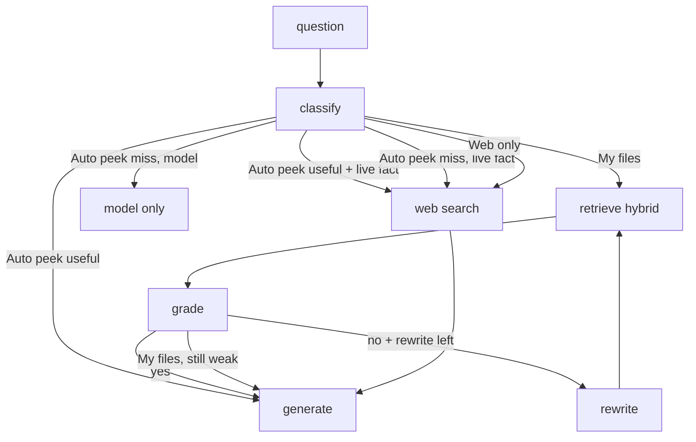
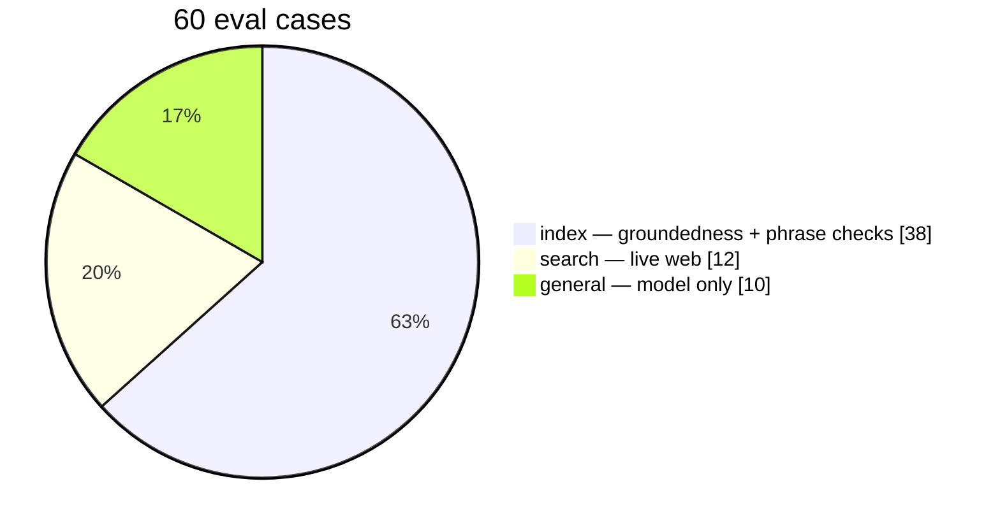
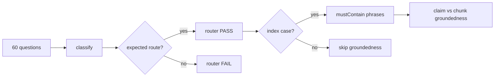

# Adaptive RAG

Next.js app that routes each question through a LangGraph.js graph: indexed documents, live web search, or the model alone. Sign in first. Chats and uploads belong to that account. On Auto, the graph peeks at this account’s files and the sample corpus; if those chunks state the fact, it answers from them, otherwise it chooses the web or the model. You can force **My files** or **Web only**, or lock answers to one indexed file. Every reply shows whether it came from your files, the web, both, or the model. My files may rewrite a weak hit once and still does not call the web.

## Graph



On Auto, classify embeds the question and hybrid-searches sample files plus this account’s chunks, then grades them. A useful peek is the answer context. A miss does not open the index again. My files still retrieves, grades, and may rewrite once.

Retrieve is hybrid: Qdrant vector search plus keyword search, fused with reciprocal rank fusion. If the question names a `.txt` file, those chunks are used first. Clicking a file in the sidebar retrieves that source only.

`npm run eval` calls `runAdaptiveRag(question)` with no mode, so the 60 cases stay on Auto.

## Metrics

Latest local run ([eval/RESULTS.md](eval/RESULTS.md), 2026-11-07):

| Metric                          | Score     |
| ------------------------------- | --------- |
| Router accuracy                 | **60/60** |
| Phrase checks (index facts)     | **38/38** |
| Groundedness (claims in chunks) | **76/84** |

`npm run eval` refreshes those files.





| What            | How it is measured                                            |
| --------------- | ------------------------------------------------------------- |
| Router accuracy | Actual `route` vs `expectedRoute`                             |
| Phrase checks   | Index answers must include listed facts from the sample files |
| Groundedness    | Each index claim is checked against retrieved chunks          |
| Hop time        | Milliseconds per graph node, shown under each chat answer     |
| Sources         | Filenames / URLs cited on the answer                          |

## Knowledge base

These files are seeded into Qdrant on first use (and any missing sample is added later):

| File                                                                             | Facts                                                                |
| -------------------------------------------------------------------------------- | -------------------------------------------------------------------- |
| [data/sample/azure-ai.txt](data/sample/azure-ai.txt)                             | Adaptive RAG, Azure AI Search, Document Intelligence, Content Safety |
| [data/sample/langgraph-orchestrator.txt](data/sample/langgraph-orchestrator.txt) | LangGraph.js, `classify` vs `route`                                  |
| [data/sample/qdrant-store.txt](data/sample/qdrant-store.txt)                     | Collection, hybrid retrieve, RRF                                     |
| [data/sample/mongodb-sessions.txt](data/sample/mongodb-sessions.txt)             | Sessions, `localStorage` key, 16-turn window                         |
| [data/sample/tavily-search.txt](data/sample/tavily-search.txt)                   | Tavily, 4 results, `keptDocs`                                        |
| [data/sample/eval-and-grade.txt](data/sample/eval-and-grade.txt)                 | Grade is read-only, rewrite budget is one                            |
| [data/sample/models-and-chunking.txt](data/sample/models-and-chunking.txt)       | `gpt-4o-mini`, 1000 / 150 chunks                                     |
| [data/sample/product-scope.txt](data/sample/product-scope.txt)                   | Three routes, APIs, CI. The file still says “no login” for the eval. |

## Setup

1. Copy `.env.example` to `.env.local`. Set `OPENAI_API_KEY`, or the Azure OpenAI variables. Set `TAVILY_API_KEY` for web search.
2. Start MongoDB and Qdrant:

```bash
docker compose up -d
```

3. Install and run:

```bash
npm install
npm run dev
```

Open [http://localhost:3000](http://localhost:3000) and sign up. Sample files under `data/sample/` are indexed automatically and are visible to every account. Uploads are visible only to the account that added them.

Why Auto peeks at files, and why a heading catalog was not used, is [D-027](decision.md). Why chats and uploads use an account id is [D-026](decision.md).

Try:

- Index: `What rewrite budget does the Adaptive RAG demo use?`
- Search: `Who won the most recent UEFA Champions League final?`
- General: `What is 2 + 2?`

## Eval

```bash
npm run eval
```

That command:

1. Checks all **60** cases in [eval/cases.json](eval/cases.json)
2. Scores groundedness on the **38** index cases
3. Checks `mustContain` phrases on those index answers
4. Writes [eval/RESULTS.md](eval/RESULTS.md) and [eval/latest.json](eval/latest.json)

Details: [docs/EVALUATION.md](docs/EVALUATION.md).

## Screenshots (optional)

GitHub already renders the Mermaid diagrams above. Screenshots are optional. If you add any, put them in `docs/images/` and link them here:

1. Chat answer with provenance banner, quote, path chips, sources, and hop timing
2. Sidebar showing indexed files (click to lock to one file)
3. Composer with Auto / My files / Web only

You do not need a hosted demo screenshot.

## Commands

```bash
docker compose up -d
npm run dev
npm run eval
npx tsc --noEmit
npm run lint
```

CI runs `tsc` and lint on push and pull requests. Eval stays local because it needs model keys.

## Docs

| File                                         | Contents                                 |
| -------------------------------------------- | ---------------------------------------- |
| [prd.md](prd.md)                             | Product requirements                     |
| [tech-stack.md](tech-stack.md)               | Libraries and env                        |
| [decision.md](decision.md)                   | Why each stack and graph choice was made |
| [docs/ARCHITECTURE.md](docs/ARCHITECTURE.md) | Graph, APIs, persistence                 |
| [docs/REQUIREMENTS.md](docs/REQUIREMENTS.md) | FR / NFR IDs                             |
| [docs/EVALUATION.md](docs/EVALUATION.md)     | How eval works                           |
| [eval/RESULTS.md](eval/RESULTS.md)           | Latest scores                            |
| [AGENTS.md](AGENTS.md)                       | Short project notes                      |
